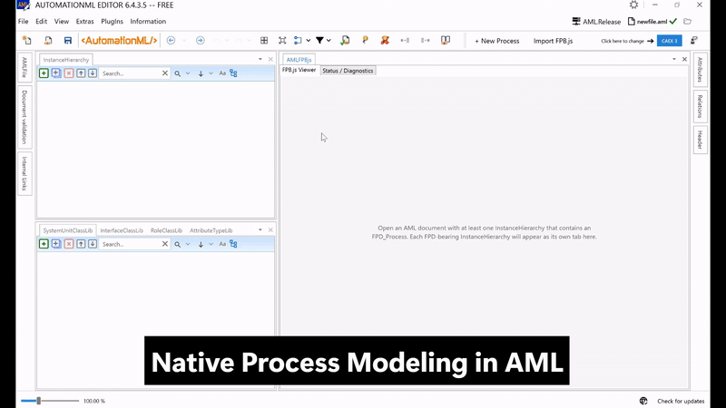

# AMLFPB.js

An [AutomationML Editor](https://www.automationml.org/) plugin that embeds the [FPB.js](https://github.com/hamiedNabizada/FPB.js) modeller for editing VDI 3682 Formalised Process Descriptions (FPD) directly in the editor — without switching tools and without losing custom AML attributes along the way.

This is research-quality software. APIs are not yet stable.



## What it does

- **Native FPD authoring inside the editor.** Open any AML document that carries FPD content and edit it visually — process operators, states, flows, decomposition, the full VDI 3682 vocabulary.
- **Lossless round-trip.** Custom attributes, InternalLinks, and other CAEX content that lives next to the FPD elements survive every edit. The classic standalone mapper rewrites the document on each conversion; the plugin updates in place.
- **Two-way live sync with the AML tree.** Edits made in the AML tree show up in the diagram within a few seconds. Edits in the diagram land in the tree when you click **Update InstanceHierarchy** or press `Ctrl+S` in the diagram, which also saves the file.
- **Selection follows both ways.** Click an element in the AML tree and the diagram shows it on its layer; click an element in the diagram and the tree jumps to its InternalElement.
- **One list of findings.** The model check of FPB.js (markers on the elements) and the plugin's own VDI 3682 check (structure, ids, references) fill one list below the diagram, each finding once.
- **Multi-IH support.** One viewer sub-tab per FPD InstanceHierarchy in the active document.
- **Decomposition.** Decompose a process operator into a sub-process, edit it on its own layer, compose it back. Boundary states stay synchronised across layers.

## Requirements

- AutomationML Editor 6.4.0 or newer
- Windows with WebView2 runtime installed
- For building from source: .NET 8 SDK, Node.js 20+ and the FPB.JS repository next to this one (the plugin bundles FPB.js 2.1)

## Installation

From nuget.org (since 0.9.0):

1. In the AutomationML Editor, open the Plug-In Manager and choose the source **PublicSource** (nuget.org).
2. Install **AMLFPB.js** (package `Aml.Editor.Plugin.FPB`).
3. Restart the editor. The plugin appears as the "AMLFPBjs" tab.

Without nuget.org: download `Aml.Editor.Plugin.FPB.<version>.nupkg` from the [releases page](https://github.com/hsu-aut/AMLFPB.js/releases), add a local source in the Plug-In Manager that points at the folder with the file, and install it from there.

## Usage

After installation, open any AML document with FPD content, or use **New Process** in the plugin's empty tab to start one. Once a process is open, the same command is in each tab's **Process** menu.

### Editing flow

- Changes in the FPB.js viewer are buffered until you click **Update** in the tab's toolbar; a dot before the tab name shows that there are some. Update writes them into the CAEX document.
- `Ctrl+S` in the diagram applies the buffered changes and saves the AML file through the editor in one step, including what you just typed into a field. Saving through the editor's own menu does not take them; the status line then says so.
- Changes in the AML tree are picked up by the viewer automatically after a few seconds. **Refresh** forces an immediate refresh.
- If the AML tree changes while the diagram has buffered changes, nothing is dropped: a bar above the diagram asks whether to **Apply diagram** (the diagram wins where both changed the same element) or **Reload from AML** (the diagram changes go, a backup stays in `%TEMP%\fpb-plugin\pending-backup`).
- With the focus in the diagram, its shortcuts (`Ctrl+Z`, `Ctrl+Y`, `Delete`, `Ctrl+C`, `Ctrl+V`, `Ctrl+F`, ...) act in the diagram only; the editor does not undo, delete or copy anything in the tree.
- Deleting an element that other parts of the AML file link to (a plant hierarchy, a link drawn in the editor, a link stored in the element that points outside) asks first and names those links: applying the diagram removes them. The list follows the whole file within a few seconds. A port that such a link shares with a flow stays when only the flow is deleted.
- **Export** in the FPB.js toolbar saves the diagram as JSON, VDI 3682 XML, SVG, PNG or PDF through the Windows save dialog. Links in the FPB.js information dialog open in the default browser.
- **View only** in the toolbar locks the diagrams of all tabs: zoom, pan, switch layers, search, check and export still work, but nothing can be moved, created, renamed or deleted. Click it again to edit. The plugin remembers the choice.

### Decomposition

Right-click a process operator and choose **Decompose**. The plugin creates a sub-process layer and links its boundary states back to the parent. Switch between layers via the layer panel and edit each in isolation — edits to boundary states propagate to the other layer because they represent the same logical element.

### New processes and JSON exchange

All in the **Process** menu of each tab; New Process and Import also in the empty tab while the document has no FPD content:

- **New Process** creates an empty FPD InstanceHierarchy.
- **Import FPB.js JSON** adds a new IH from a `.json` file produced by [fpbjs.net](https://www.fpbjs.net) or any other FPB.js-based application.
- **Export JSON** writes the current IH content to a `.json` file.
- **Export Conformance Report** writes a machine-readable VDI 3682 validation summary.

The editor toolbar carries no commands of this plugin: the editor shows the toolbar of one plugin at a time, so with other plugins loaded they would appear in the wrong tab.

## Architecture

```
AutomationML Editor                AMLFPB.js                          FPB.js
                                   ─────────                          ──────
DocumentLoaded         ─►  FpbPlugin
ChangeSelectedObject   ─►  ├── IhView (one per IH)
                           │   ├── WebView2  ◄── importJSON ◄────────  Diagram
                           │   ├── Bridge                              + UI
                           │   ├── pending snapshot
                           │   └── hash-poll live sync
                           │
                           └── calls the mapper:
                               ├── FpbJsonToCaex.UpdateInPlace     ──► CAEX
                               ├── FpbJsonToCaex.ImportInto
                               ├── CaexToFpbJson.Convert            ◄── CAEX
                               └── Vdi3682Validator
```

The plugin itself handles tab lifecycle, the host-to-JavaScript bridge, diagnostics, and editor integration. CAEX conversion and VDI 3682 validation live in [`fpb-aml-mapper`](https://github.com/hsu-aut/fpb-aml-mapper). The diagram surface, palette, layer panel, and properties panel come from [`FPB.js`](https://github.com/hamiedNabizada/FPB.js).

## Build from source

The plugin needs both sibling repositories cloned next to it:

```
<parent>/
├── fpb-aml-editor-plugin/
├── fpb-aml-mapper/
└── FPB.JS/
```

Build:

```powershell
cd FPB.JS
npm install
npm run build

cd ..\fpb-aml-editor-plugin
dotnet build Aml.Editor.Plugin.FPB.sln -c Release
```

The resulting `.nupkg` lands in `build\Plugins\Aml.Editor.Plugin.FPB\Release\`.

Tests: `dotnet test Aml.Editor.Plugin.FPB.Tests`. The page inside the WebView (`fpbjs-assets/index.html`) and its messages to the plugin are tested in Chromium with a stand-in for the WebView2 bridge:

```powershell
cd PageTests
npm install
npx playwright test
```

They load FPB.js from `..\..\FPB.JS\dist` (or `FPBJS_DIST`).

## Known limitations

Two pieces of functionality use reflection or polling because the editor's plugin API does not expose them:

- The auto-save trigger looks up `SaveAMLCommand` on `Application.Current.MainWindow.DataContext`. If the editor renames or restructures it, the plugin falls back to manual `Ctrl+S`.
- The AML-tree to viewer synchronisation polls a SHA-256 of the IH XML every two seconds, because Aml.Engine has no public change event.

Both paths are monitored at startup by a compatibility check; any drift shows up as a banner in the plugin's Diagnostics tab. Verbose log output lives under `%TEMP%\fpb-plugin\fpb-plugin-debug.log`.

The WebView keeps its profile under `%LOCALAPPDATA%\AMLFPB.js\WebView2`, so the plugin also runs when the editor is installed under Program Files. It shows only its own page: other navigation is refused and logged, and messages from any other source are dropped.

## Configuration

Settings are persisted in `%APPDATA%\AutomationMLEditor\FpbPlugin\settings.json`:

| Key | Default | Effect |
|---|---|---|
| `debug_logging` | `false` | Forwards the JavaScript console to the log file; tabs opened afterwards also get the browser's context menu with Inspect (the DevTools). |
| `auto_save_after_update` | `false` | Triggers the editor's save command after each Update InstanceHierarchy. |
| `run_vdi_validation` | `true` | Runs the VDI 3682 checks and fills the findings list; off also hides the markers of FPB.js. |
| `confirm_large_updates` | `true` | Shows a confirmation dialog when an update would touch many elements or connections. |
| `update_safety_threshold` | `5` | Threshold for the confirmation dialog. |
| `view_only` | `false` | The diagrams take no edits (the **View only** toggle in each tab's toolbar). |
| `pending_age_warning_minutes` | `30` | Warns before applying a pending edit older than this. |
| `disabled_validation_rules` | `[]` | List of VDI 3682 rule IDs to skip during validation. |

The boolean toggles are exposed in the plugin's Diagnostics tab, `view_only` in each tab's toolbar. The numeric values are edited in the JSON file directly.

### Language

The plugin speaks English or German, as the display language of Windows says, the same way the OPC UA plugin does; the AML Editor itself stays English. The environment variable `AMLFPB_LANGUAGE` (`en` or `de`) overrides it, for screenshots and support. The diagram of FPB.js follows: the plugin opens its page with `?lang=de` or `?lang=en`. The messages of the mapper, of the OCL rule file and of the log file stay English, as does the conformance report.

## License

[MIT](LICENSE).
